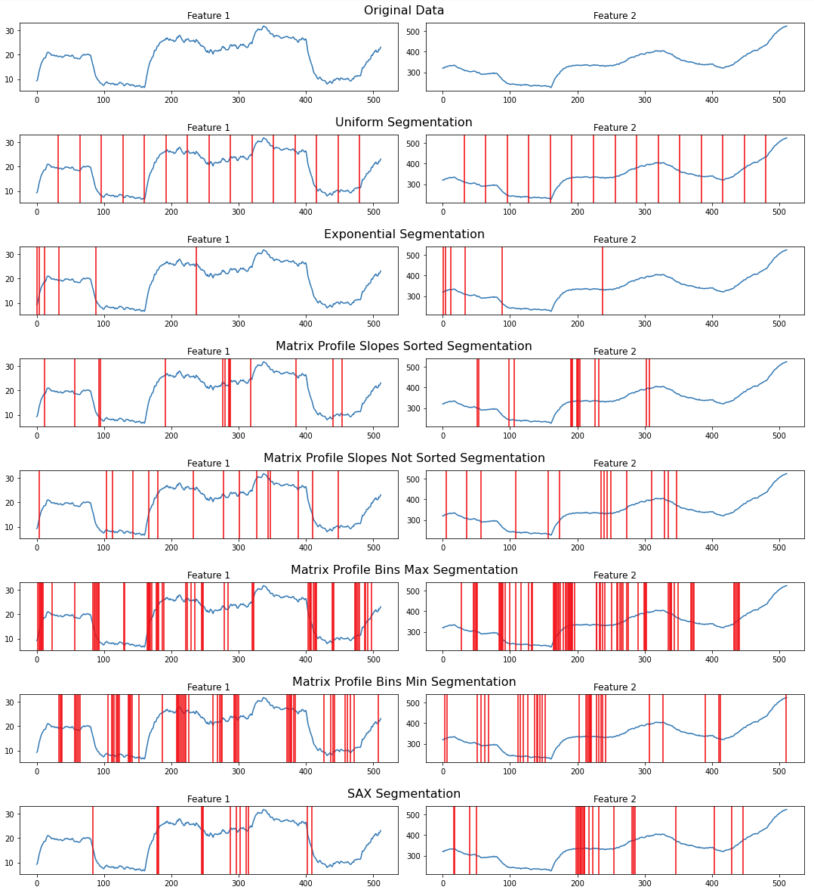
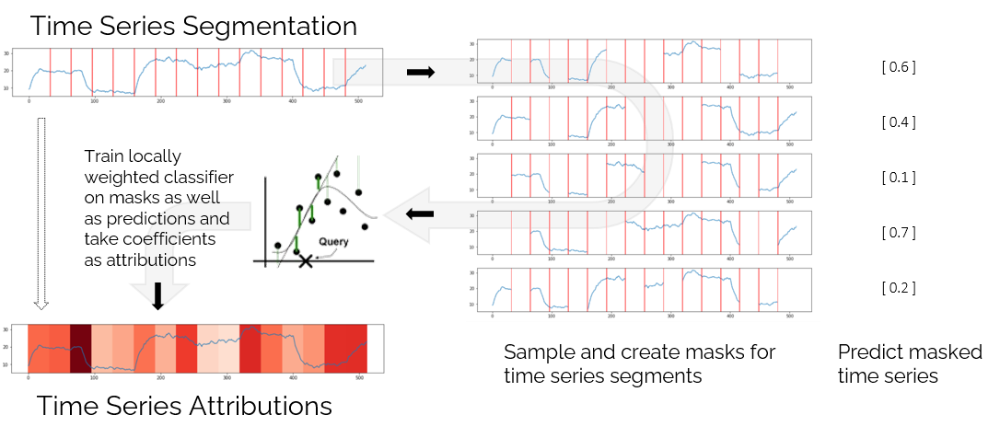
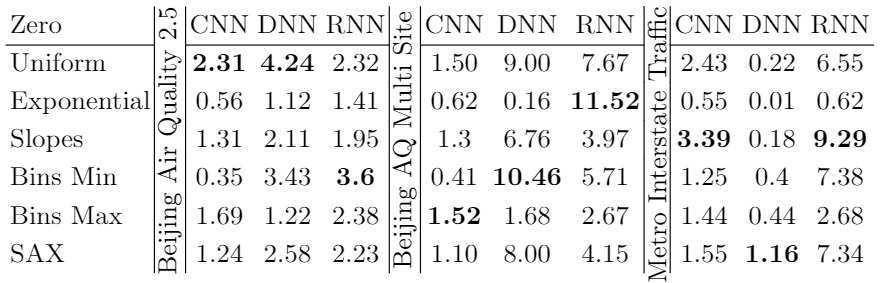

# Time Series Multivariate and Univariate Local Explanations (TS-MULE)

Repository for the paper *"Local Interpretable Model-Agnostic Explanations For Time Series Forecast Models"* ([AIMLAI 2021](https://project.inria.fr/aimlai/previous-editions/aimlai-ecml-2021/program/ "Advances in Interpretable Machine Learning and Artificial Intelligence 2021")).
`tsmule` extends LIME [1] for **univariate and multivariate time series forecasting and classification** with dedicated time series segmentation algorithms and perturbation replacement strategies.

## Segmentation & Replacement Strategies

Seven segmentation algorithms are included:
- **Uniform** (`WindowSegmentation`, `segmentation_method='uniform'`): fixed-size non-overlapping windows.
- **Exponential** (`WindowSegmentation`, `segmentation_method='exponential'`): exponentially growing windows.
- **SAX** (`SAXSegmentation`): segmentation based on Symbolic Aggregate approXimation (SAX) symbols.
- **Slopes-sorted** (`MatrixProfileSegmentation`, `segmentation_method='slopes-sorted'`): steepest jumps on the sorted matrix profile.
- **Slopes-not-sorted** (`MatrixProfileSegmentation`, `segmentation_method='slopes-not-sorted'`): steepest slopes on the unsorted matrix profile.
- **Bins-min** (`MatrixProfileSegmentation`, `segmentation_method='bins-min'`): matrix profile binning minimizing overlapping point labels.
- **Bins-max** (`MatrixProfileSegmentation`, `segmentation_method='bins-max'`): matrix profile binning maximizing overlapping point labels.

Supported replacement strategies (`tsmule.sampling.replace`):
- `zeros`
- `local_mean` / `global_mean`
- `inverse_mean` / `inverse_max`
- `local_noise` / `global_noise`
- `random`

## Installation

```bash
git clone https://github.com/dbvis-ukon/ts-mule.git
cd ts-mule
pip install -r requirements.txt
pip install -e .
```

For development (linting and tests):
```bash
pip install -r requirements-dev.txt
pip install -e .
make test
make lint
```

## Quick Start

### Explaining a Forecasting Model
```python
import numpy as np
from tsmule.xai.lime import LimeTS

sample = np.sin(np.linspace(0, 6, 40)).reshape(-1, 2)
predict_fn = lambda x: float(x.sum())

explainer = LimeTS(partitions=6, win_length=4, n_samples=100, random_state=42)
relevance = explainer.explain(sample, predict_fn, segmentation_method='slopes-sorted')
```

### Explaining a Time Series Classifier (FordA & Earthquakes Examples)
`LimeTS.explain` supports classification `predict_proba` functions (automatically explaining the predicted `argmax` class or an explicit `target_class`, with optional `batch_predict=True` for fast batch inference):

```python
from sklearn.linear_model import Ridge
from tsmule.xai.lime import LimeTS

explainer = LimeTS(kernel=Ridge(alpha=1.0), n_samples=200, random_state=42)
relevance = explainer.explain(
    sample_1d,
    model.predict_proba,
    segmentation_method='slopes-sorted',
    batch_predict=True,
)
```

Run the end-to-end **UCR FordA** classification example (downloads and caches FordA automatically, trains an RBF-SVM classifier, explains test predictions across all 7 segmenters, and evaluates faithfulness with `PerturbationAnalysis`):
```bash
python examples/ford_a/ford_a_classification.py --n-explain 40 --n-samples 200
```
See also [examples/ford_a/FordA_classification.ipynb](examples/ford_a/FordA_classification.ipynb).

Run the **UCR Earthquakes** classification example (downloads and caches Earthquakes automatically, trains a balanced Random Forest classifier, explains test predictions across all 7 segmenters, and evaluates ROC-AUC and Brier score faithfulness):
```bash
python examples/earthquakes/earthquakes_classification.py --n-explain 60 --n-samples 200
```
See also [examples/earthquakes/Earthquakes_classification.ipynb](examples/earthquakes/Earthquakes_classification.ipynb).

## Comparison of Segmentation Algorithms



## Workflow

The corresponding workflow with LIME adapted to time series:


## Results

We evaluate the proposed segmentation algorithms for TS-MULE with a perturbation analysis based on Schlegel et al. [2].
In our paper, we focused on zero perturbation, and also report results for zero, inverse-mean, and global-mean.



In general, we advise using `uniform` or `bins-min` for short window lengths, and `slopes` (or `bins-min`) for larger window lengths.

## Citation

If you use `tsmule` in your research, please cite:

```bibtex
@inproceedings{schlegel2021tsmule,
  title={{TS-MULE}: Local Interpretable Model-Agnostic Explanations for Time Series Forecast Models},
  author={Schlegel, Udo and Vo, Duy Lam and Keim, Daniel A. and Seebacher, Daniel},
  booktitle={Advances in Interpretable Machine Learning and Artificial Intelligence (AIMLAI) Workshop at ECML PKDD},
  year={2021}
}
```

## License

This project is licensed under the [MIT License](./LICENSE).

## Acknowledgments

This project has received funding from the European Union’s Horizon 2020 research and innovation programme under grant agreement No. 826494.

## References

[1]: Ribeiro, M. T., Singh, S., & Guestrin, C. (2016, August). "Why should i trust you?" Explaining the predictions of any classifier. In Proceedings of the 22nd ACM SIGKDD international conference on knowledge discovery and data mining (pp. 1135-1144).  
[2]: Schlegel, U., Arnout, H., El-Assady, M., Oelke, D., & Keim, D. A. (2019). Towards A Rigorous Evaluation Of XAI Methods On Time Series. In 2019 IEEE/CVF International Conference on Computer Vision Workshop (ICCVW) (pp. 4321-4325).
